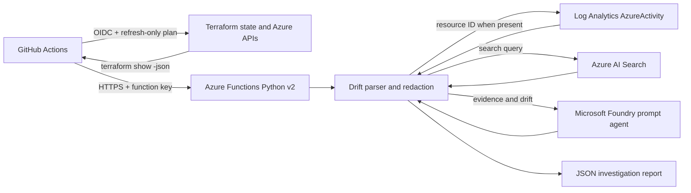

# Architecture

## Implemented Flow

The platform investigates actual Azure drift, not ordinary Terraform configuration changes. GitHub
Actions runs `terraform plan -refresh-only -detailed-exitcode`, exports the plan with
`terraform show -json`, and posts it to an authenticated Azure Function. The Function reads the
Terraform `resource_drift` field, redacts sensitive values, optionally queries Activity Logs and
Azure AI Search, and asks a Microsoft Foundry prompt agent for a bounded recommendation.

## Deployed Components

| Component | Current implementation |
| --- | --- |
| Terraform | AzureRM 4.x and AzAPI 2.x; development resource group, Function, storage, monitoring, Foundry project, Search service, RBAC, and subscription Activity Log diagnostics. |
| Azure Function | Python v2 HTTP endpoint at `/api/investigate`; function authorization key required. |
| Drift analysis | Reads `resource_drift` only; proposed `resource_changes` do not count as drift. Property changes marked sensitive are redacted. |
| Microsoft Foundry | `AIServices` Foundry resource and project; prompt agent created from the version-controlled recommendation instructions. Calls use `azure-ai-projects` 2.x and Entra ID. |
| Azure AI Search | Entra-authenticated full-text index for approved Markdown/text knowledge sources. Current indexer is `scripts/index_documents.py`. |
| Activity evidence | Optional `AzureActivity` query in Log Analytics for the resource ID from the Terraform plan. Caller is reported as recorded evidence, not as verified intent. |
| State and CI | Azure Storage remote state; GitHub Actions uses OIDC for Azure and a Function key for the HTTP call. |

The Foundry ARM account is represented by `Microsoft.CognitiveServices/accounts` with kind
`AIServices`; this is the current Foundry resource shape, not a standalone legacy Azure OpenAI
resource. Model selection and deployment are separate because availability, quota, and model names
depend on the subscription and region.

## Boundaries and Security

- The Function identity receives Foundry User on the project, Search Index Data Reader on Search,
	and Log Analytics Reader on the workspace.
- The Function host currently uses its backing Storage account key through the AzureRM Function
	resource. That key is held in protected Terraform state; restrict state access and enable storage
	recovery controls. This is not an application-level AI credential.
- GitHub authenticates to Azure with federated OIDC. A Function key is stored as a GitHub Actions
	secret and sent in the `x-functions-key` header.
- Terraform plan JSON can contain sensitive data. It is sent only over HTTPS to the Function and
	is not uploaded as a workflow artifact. The parser redacts Terraform-marked sensitive fields in
	its report.
- The development stack uses public service endpoints with Entra authorization. Private endpoints,
	private DNS, and network-restricted Function integration must be designed before production.

## Not Implemented Yet

The original drawings were broader than the checked-in code. Service Bus, Cosmos DB, durable
retries, PIM or Microsoft Graph lookup, direct Resource Graph change-history calls, vector/agentic
retrieval, and Teams/GitHub/ServiceNow notifications are not part of this deployment. There is no
investigation-history store. The Kusto files are query references, not runtime integrations.

## Microsoft References

- [Microsoft Foundry SDK and endpoint guidance](https://learn.microsoft.com/azure/ai-foundry/how-to/develop/sdk-overview)
- [Microsoft Foundry Agent Service overview](https://learn.microsoft.com/azure/ai-foundry/agents/overview)
- [Azure AI Search overview](https://learn.microsoft.com/azure/search/search-what-is-azure-search)
- [Terraform plan JSON format](https://developer.hashicorp.com/terraform/internals/json-format)