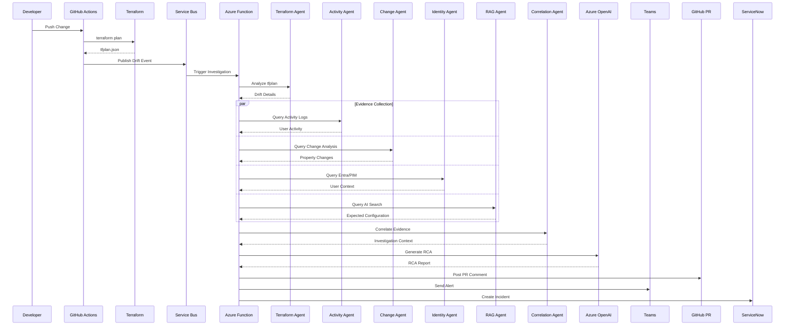

# Terraform Drift Investigation Sequence Diagram

---

# Investigation Timeline

1. Drift detected
2. Investigation triggered
3. Evidence collected
4. User identified
5. Configuration baseline retrieved
6. RCA generated
7. Notifications dispatched